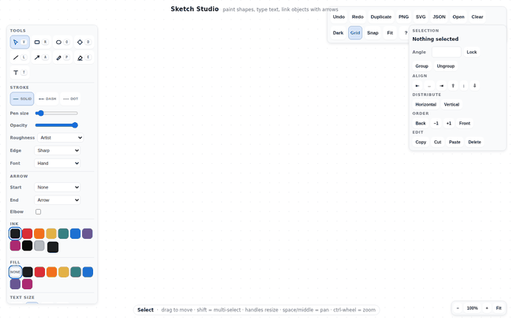

# Sketch Studio

> ### A toy app, written by a local model
> 
> This is a toy drawing app built entirely using **`local/qwen3.8-flash-next-coder`** — a Qwen3.8-Flash-Next GGUF at **IQ1_M quantization**, assisted by a speculative draft model.
> The model runs locally on a MacBook, served by **Splash** (`splash serve --offline --host 127.0.0.1`) and driven through the **pi** coding agent with some of its coding skills at `high` reasoning effort.
> **No cloud models, no API calls, no telemetry.** Everything runs locally.
> The goal is to explore **what a heavily quantized local model can build in a few hours**. The app now includes 214 unit tests and a broad, still dependency-free feature set, with minimal review beyond running it in a browser.

A hand-drawn editor for the browser: paint sketchy shapes, type text, and
connect objects with arrows that stay attached when you move things around.

No dependencies, no build step, no network calls — everything happens in one
HTML page and saves to your browser's local storage.

## See it



Not a mock-up: every frame is the live app in headless Chromium. The 24-second
loop draws a rectangle, ellipse and diamond, fills them, double-clicks a label
onto the rectangle, binds an elbow arrow between two shapes, moves the ellipse
so the arrow follows, rotates the diamond, groups and aligns two shapes,
copies/pastes, pans and zooms to fit, toggles grid and snap, switches to dark
mode, changes opacity/roughness/dash in the properties panel, exports SVG, and
finally opens a corrupt JSON file: the toast reports what was repaired and the
drawing survives. Regenerate with `python3 tools/make_gif.py`; Playwright and
Pillow are not project dependencies, so use a throwaway venv:

```bash
python3 -m venv ~/.cache/sketch-studio-venv
~/.cache/sketch-studio-venv/bin/pip install playwright pillow
~/.cache/sketch-studio-venv/bin/playwright install chromium
~/.cache/sketch-studio-venv/bin/python tools/make_gif.py
```

## Run

```bash
npm start          # then open http://localhost:4171
```

Needs Python 3 (stdlib `http.server`, nothing to install); `npm start` is just
`python3 -m http.server 4171`. That server sends no `Cache-Control` header, so
after editing `assets/` do a hard reload (`Cmd+Shift+R`) to skip the browser's
cached copy. Node 20+ is only needed for the tests.

## Test

```bash
npm test           # Node 20+; runs the DOM-free unit tests in tests/
```

## What it does

| Tool | Key | Behaviour |
| --- | --- | --- |
| Select | `V` | click / shift-click, marquee drag, move, 8 resize handles, multi-element resize, rotation handle, arrow-key nudge |
| Rect | `R` | jittered corners, straight edges; `Shift` constrains to a square |
| Ellipse | `O` | `Shift` constrains to a circle |
| Diamond | `D` | rhombus through the box edge midpoints |
| Line | `L` | `Shift` snaps to 15° steps |
| Arrow | `A` | docked ends follow their shapes; drag a bend point to add a vertex; elbow routing |
| Pen | `P` | freehand stroke |
| Eraser | `E` | drag across shapes to delete them |
| Text | `T` | click to type, `Enter` for a newline, `Esc` to commit |
| Image | — | insert, paste or drop PNG/JPEG/GIF/WebP; stored as a validated data URL |

Style controls: stroke width, solid/dashed/dotted, palette plus a custom colour
picker, fill (none or 8 colours at 35% alpha), opacity, roughness
(architect/artist/cartoonist), sharp/round edges, three font families, text
size, and arrowheads per end (none/arrow/triangle/dot).

Editing actions: undo/redo (bounded history), duplicate, copy/cut/paste with
in-app and system-clipboard JSON, group/ungroup, lock/unlock, align six edges,
distribute horizontally/vertically, bring to front/back and forward/backward,
clear, and a right-click context menu.

Canvas and UX: infinite pan (space+drag, middle-drag, wheel/trackpad), anchored
zoom (Ctrl/⌘+wheel, pinch, buttons), zoom indicator, zoom-to-fit and
zoom-to-selection, grid toggle and snap, light/dark theme, a properties panel
that reflects the current selection, toasts, and a `?` shortcut overlay.

Anything centred inside a shape — including a label you typed — re-centres
when that shape moves or resizes. Labels rotate with their container.

## Shortcuts

| Shortcut | Action |
| --- | --- |
| `V` `R` `O` `D` `L` `A` `P` `E` `T` | select / rect / ellipse / diamond / line / arrow / pen / eraser / text |
| `Space`+drag, middle-drag, wheel | pan |
| `Ctrl/⌘`+wheel, pinch | zoom at the cursor |
| `Ctrl/⌘` `+` / `-` / `0` / `1` / `2` | zoom in / out / reset / fit all / fit selection |
| `Ctrl/⌘+Z`, `Shift+Ctrl/⌘+Z`, `Ctrl/⌘+Y` | undo / redo / redo |
| `Ctrl/⌘+A`, `Ctrl/⌘+D` | select all / duplicate |
| `Ctrl/⌘+C`, `Ctrl/⌘+X`, `Ctrl/⌘+V` | copy / cut / paste |
| `Ctrl/⌘+G`, `Shift+Ctrl/⌘+G` | group / ungroup |
| `Ctrl/⌘+Shift+L` | toggle lock |
| `Ctrl/⌘+]`, `Ctrl/⌘+[` | forward / backward; add `Shift` for front / back |
| Arrow keys, `Shift`+arrows | nudge 1 px / 10 px |
| `Delete` / `Backspace` | delete selection |
| `G`, `S` | toggle grid / snap |
| `?`, `Esc` | shortcut help / cancel, deselect, close menu |

## Fault tolerance

The drawing is treated as data that must survive bad input, bad saves and
concurrent tabs. Every load path — localStorage, opened JSON and clipboard —
goes through the same validator before anything reaches the renderer.

- **Validate and repair, never drop the scene.** `src/schema.js` repairs
  recoverable elements (bad coordinates, colours, enums, duplicate ids,
  dangling bindings/containers) and drops only unrecoverable ones. The UI
  reports what happened instead of failing silently.
- **Schema versioning.** Scenes are version 2; version 1 and unversioned data
  are migrated by filling missing fields only.
- **Atomic debounced autosave.** `src/persistence.js` writes a pending copy,
  promotes it to current, keeps the previous good snapshot as backup, and
  maintains a ring of the last five good snapshots. Corrupt current data is
  never allowed to overwrite the backup.
- **Quota and unavailable storage.** `QuotaExceededError` and private-mode
  storage failures are detected, surfaced as toasts, and do not lose the
  in-memory drawing. Reads still work when the quota is full.
- **Multi-tab conflicts.** Revision numbers detect another tab changing the
  drawing. The user gets `Load other tab` / `Keep mine` instead of a silent
  overwrite; closing the tab does not flush over an unresolved conflict.
- **Bounded, validated undo.** History is capped (100 entries); corrupt or
  missing snapshots are skipped rather than crashing undo.
- **Error boundary and recovery export.** Guarded handlers catch unexpected
  failures, show a toast, and offer a recovery JSON download.
- **Import guards.** File size, element count, JSON parse errors, markup-like
  text and image MIME/size/data-URL checks are rejected before use. User text
  is rendered with canvas text and escaped SVG — never via `innerHTML`.
- **Fault-tolerant UI.** A single bad element cannot abort the render; export
  and load failures are reported without destroying the current scene.

The unit suite covers these paths with injectable storage, timers and id
factories, including corrupt fixtures and quota/unavailable storage.

## Layout

```
index.html          markup, toolbar, properties panel, help/toasts/context menu
assets/app.js       DOM, canvas sizing, gestures, toolbar state, persistence, shortcuts
assets/render.js    viewport-aware canvas painting (strokes, fills, images, handles, caret)
assets/styles.css   light/dark layout and chrome
src/schema.js       versioning, migration, validation and repair
src/persistence.js  debounced atomic autosave, backup/ring, quota, multi-tab revisions
src/import.js       file/clipboard guards, markup detection, escaping
src/errors.js       error boundary, toasts, recovery payload
src/scene.js        element store, bounded validated history, selection model
src/viewport.js     pan, anchored zoom, fit, grid snap
src/geometry.js     bounds, rotated hit-testing, connector routing, rotation handles
src/arrange.js      z-order, groups, lock, align, distribute, nudge
src/clipboard.js    validated in-app/system clipboard, paste remapping
src/text.js         caret editing, label placement
src/rough.js        deterministic sketchy paths and arrowhead geometry
src/export.js       escaped SVG export, selection bounds, themes, images
src/tools.js        drafts, constraints, connector vertices, rotation handles, palette
src/images.js       MIME/size/data-URL guards, fitting, image elements
src/properties.js   mixed-selection reflection and style patches
tests/*.test.mjs    unit tests for the DOM-free layers
tools/make_gif.py   regenerates the demo GIF (Playwright + Pillow)
```

The `src/` layer has no DOM access, which is what keeps it unit-testable.

## License

MIT (see `LICENSE`). Fonts are referenced by system name only; no font files
or other third-party assets are distributed.
